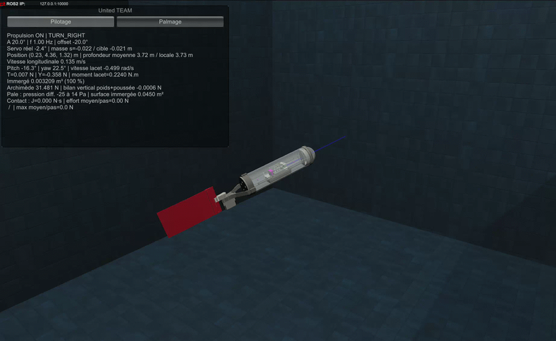
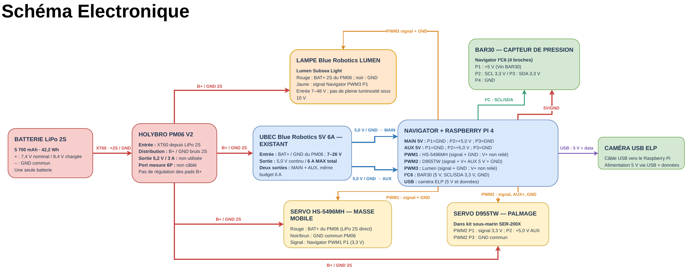

<h1 align="center">United Team</h1>

<p align="center">
  <strong>Robot-poisson pour l'exploration karstique</strong><br>
</p>

<p align="center">
  Kadijatou Diallo · Elodie Conan · Luíza Diesel Chesani · Tom Voisine · Alexandre Pinard · Matys BIECHE
</p>

[](Image/Team%20United.png)

<p align="center">
  <a href="#télécharger-le-simulateur">Téléchargements</a> ·
  <a href="#simulation-unity">Simulation</a> ·
  <a href="#ros-2-et-logiciel-embarqué">ROS 2</a> ·
  <a href="#modèle-physique-et-hypothèses">Modèle physique</a> ·
  <a href="#validation-et-reproductibilité">Validation</a> ·
  <a href="#organisation-du-dépôt">Organisation</a> ·
  <a href="#mécanique">Mécanique</a> ·
  <a href="#électronique">Électronique</a> ·
  <a href="#budget">Budget</a>
</p>

Nous développons un robot aquatique propulsé par une palme, dont l'assiette est modifiée par une masse mobile interne. Le dépôt rassemble la conception du robot, le logiciel destiné au Raspberry Pi et à la carte Navigator, ainsi qu'un simulateur permettant d'explorer son comportement dans une piscine et des galeries karstiques inondées.

## Télécharger le simulateur

**Aucune installation de Unity n'est nécessaire pour utiliser les builds.** Télécharger l'archive correspondant à votre système, puis l'extraire entièrement avant de lancer le simulateur.

| Plateforme | Téléchargement du build complet | Exécutable après extraction |
| --- | --- | --- |
| Linux x86_64 | [**Télécharger pour Linux (.zip)**](https://github.com/Ingenierie-Systeme/united-team-repo/raw/refs/heads/main/downloads/United-Team-Linux-x86_64.zip) | `United-Team-Linux/Simulator_Linux.x86_64` |
| Windows x86_64 | [**Télécharger pour Windows (.zip)**](https://github.com/Ingenierie-Systeme/united-team-repo/raw/refs/heads/main/downloads/United-Team-Windows-x86_64.zip) | `United-Team-Windows/IngeSys.exe` |


**Windows :** extraire le ZIP, ouvrir `United-Team-Windows`, puis lancer `IngeSys.exe`.

**Linux :** extraire le ZIP, ouvrir un terminal dans le dossier contenant `United-Team-Linux`, puis exécuter :

```bash
cd United-Team-Linux
chmod +x Simulator_Linux.x86_64
./Simulator_Linux.x86_64
```

### Commandes du simulateur

Cliquer dans la fenêtre du simulateur pour activer les commandes clavier.

| Touche | Action |
| --- | --- |
| `W` | Activer / désactiver la propulsion |
| `↑` / `↓` maintenues | Déplacer la consigne de masse vers l'avant / l'arrière |
| `R` | Recentrer progressivement la masse mobile |
| `←` / `→` | Sélectionner le virage gauche / droite ; un second appui identique revient en ligne droite |
| `F` | Allumer / éteindre la lampe |
| `V` | Alterner entre les vues de base, embarquée et arrière |

## Simulation Unity

[](Image/Simu.gif)

**[Ouvrir le dossier du projet Unity](<Simulateur Unity/IngeSys/IngeSys>)** · Version de l'éditeur : **6000.6.5f1**.

La scène principale est [`RobotFishKatarstique.unity`](<Simulateur Unity/IngeSys/IngeSys/Assets/Scenes/RobotFishKatarstique.unity>) : une piscine donne accès à un puits et à un réseau de galeries inondées. Elle comporte le robot pilotable, plusieurs caméras, une lampe et une ambiance sous-marine. C'est la scène sélectionnée pour le build.

Pour travailler sur les sources, ouvrir `Simulateur Unity/IngeSys/IngeSys` dans Unity Hub avec la version indiquée, ouvrir cette scène, puis lancer **Play**.

Le modèle comprend :

- Un corps rigide à six degrés de liberté, la gravité et une flottabilité distribuée selon le volume immergé.
- Des traînées linéaires et quadratiques, ainsi qu'un amortissement angulaire.
- Une masse coulissante qui déplace le centre de gravité et modifie l'assiette.
- Une palme souple animée, dont les efforts sont calculés par un modèle de pression instantanée.
- Une surface de Gerstner commune au rendu de l'eau et au calcul d'immersion.
- Des capteurs idéaux d'IMU, de pression et de profondeur publiés vers ROS 2.


## ROS 2 et logiciel embarqué

Deux espaces distincts sont présents dans le dépôt :

| Dossier | Rôle |
| --- | --- |
| [`ROS2/`](ROS2) | Passerelle ROS-TCP-Endpoint pour Unity et scripts de vérification des capteurs simulés. |
| [`ros2_ws/`](ros2_ws) | Logiciel du robot réel sur Raspberry Pi 4 / Navigator : acquisition des capteurs, commande PWM, radiocommande SBUS, caméra USB et fusion d'attitude. |

### Capteurs simulés

La connexion utilise par défaut `127.0.0.1:10000`. Le connecteur Unity est embarqué dans `Packages/com.unity.robotics.ros-tcp-connector` ; le serveur Python se trouve dans `ROS2/src/ROS-TCP-Endpoint`.

| Topic | Type ROS 2 | Mesure |
| --- | --- | --- |
| `/imu/data` | `sensor_msgs/msg/Imu` | Orientation, vitesse angulaire et accélération spécifique |
| `/barometer/pressure` | `sensor_msgs/msg/FluidPressure` | Pression absolue en Pa |
| `/depth` | `std_msgs/msg/Float64` | Profondeur immergée en mètres, positive vers le bas |

Fréquence demandée : **20 Hz**. Les capteurs sont idéaux, sans bruit ni biais ; l'horodatage utilise l'heure UTC du système. Il n'y a pas de publication de TF ni de `/clock`.

### Robot réel

Le package [`navigator`](ros2_ws/src/navigator) contient les nœuds d'acquisition IMU/magnétomètre, de baromètre, de caméra, de réception SBUS et de fusion d'attitude. Les outils de calibration IMU sont dans [`imu_calib`](ros2_ws/src/imu_calib). Les interfaces du robot et du simulateur utilisent des noms, types et conventions différents ; elles ne sont pas directement interchangeables.

### Construction et lancement du logiciel embarqué

Sur le Raspberry Pi 4 équipé de Navigator, préparer une installation ROS 2 et `colcon`, puis les bibliothèques Python importées par les nœuds : `bluerobotics_navigator`, NumPy, `imufusion`, `pyserial`, `smbus2`, OpenCV et `cv_bridge`, ainsi que les messages ROS `sensor_msgs` et `std_msgs`. Plusieurs de ces dépendances doivent être installées séparément : elles ne sont pas toutes déclarées dans [`package.xml`](ros2_ws/src/navigator/package.xml).

Depuis la racine, dans un terminal où ROS 2 est sourcé :

```bash
cd ros2_ws
colcon build --packages-select navigator
source install/setup.bash
ros2 launch navigator all.launch.py
```

Ce lancement démarre `navigator`, `rc`, `baro`, `fusion` et `cam`. Il suppose notamment `/dev/ttyS0`, le bus I²C 6 et `/dev/video0`, ainsi que les autorisations correspondantes ; l'absence de matériel peut empêcher le démarrage. Il ne lance pas de contrôleur de propulsion. Après configuration du matériel, lancer **un seul** producteur de commandes, par exemple `ros2 run navigator rc_control` ou `ros2 run navigator manual_control`, dans un autre terminal sourcé. Les autres exécutables sont `propulsion` et `light`. Le contrôle manuel exige un terminal interactif.

### Interfaces embarquées et points de vigilance

| Producteur → consommateur | Topic et type | Contenu et comportement |
| --- | --- | --- |
| `navigator` → `fusion` | `/input/imu` (`sensor_msgs/msg/Imu`), `/input/mag` (`sensor_msgs/msg/MagneticField`) | Acquisition demandée à 100 Hz ; les messages bruts ne renseignent ni horodatage ni repère. Le magnétomètre est réorienté `(-y, x, z)`. |
| `fusion` | `/state/attitude` (`sensor_msgs/msg/Imu`) | Quaternion AHRS en convention NED, horodaté ; le dernier magnétomètre reçu est réutilisé à chaque IMU. |
| `baro` | `/input/depth` (`std_msgs/msg/Float32`) | Profondeur à 10 Hz, densité d'eau salée 1029 kg/m³ et pression de référence fixe 101300 Pa. |
| `rc` → `rc_control` | `/input/rc` (`std_msgs/msg/Float32MultiArray`) | Huit voies SBUS normalisées ; `rc_control` produit une consigne neutre après 0,5 s sans message. Les indicateurs de perte de trame et failsafe SBUS ne sont pas exploités. |
| contrôleur → `navigator` | `/output/servos` (`std_msgs/msg/Float32MultiArray`) | Au moins deux valeurs : palme puis masse, bornées à $[-1,1]$. Les canaux de l'API Navigator sont respectivement 1 et 0. |
| `light` → `navigator` | `/output/light_pwm` (`std_msgs/msg/Float32`) | Valeur transmise directement au canal 2. `light` émet -0,5, 0 ou 0,5 ; leur validité comme rapports cycliques n'est pas établie. |
| `cam` | `/camera/image_raw` (`sensor_msgs/msg/Image`) | Images BGR8 demandées à 30 Hz, horodatées. |

Le code calcule le rapport cyclique des servos par $d=0{,}075+0{,}05u$, où $u$ est la consigne bornée. À 50 Hz, cela correspond à 500–2500 µs ; les commentaires de `config.py` indiquant 1000–2000 µs pour les bornes sont incohérents. Vérifier les limites physiques et le câblage avant alimentation. Le récepteur ne valide pas la fin des trames ; le nœud Navigator ne vérifie pas la longueur du tableau ni ne fournit lui-même de délai de sécurité. Le délai du contrôleur radio ne protège pas contre tous les arrêts de processus ou pertes de communication. Les calibrations et facteurs numériques de `node_fusion.py` sont spécifiques au code et n'établissent pas une précision métrologique.

### Commande ROS du simulateur

Dans la scène principale, [`RobotRosControl.cs`](<Simulateur Unity/IngeSys/IngeSys/Assets/Scripts/ROS/RobotRosControl.cs>) permet de choisir la source de commande dans l'Inspector : clavier par défaut, `RosServoPositions` ou `RosFinParameters`. Le premier mode ROS accepte `/output/servos` comme `[palme, masse]` normalisés ; le second accepte `/robot_fish/fin_command` comme `[amplitude_rad, fréquence_Hz, offset_rad, activation_0_ou_1]` et `/robot_fish/mass_position` en mètres. Les commandes non finies sont rejetées et les consignes sont bornées. L'état est publié sur `/robot_fish/actuators_state`. Après une seconde sans commande de palme par défaut, celle-ci revient au neutre et la masse conserve sa position ; une commande de masse seule ne renouvelle pas ce délai. En mode positions externes, la propulsion moyenne est désactivée : l'utilisation du modèle de pression instantanée est nécessaire pour obtenir une force de battement de ce flux.


## Modèle physique et hypothèses

Le robot est représenté par un seul `Rigidbody` Unity : la gravité est appliquée par le moteur, tandis que les scripts ajoutent les efforts hydrodynamiques. Dans le repère local, +Z pointe vers l'avant, +X vers la droite et +Y vers le haut. Les grandeurs sont exprimées en unités SI. Ce modèle réduit permet d'étudier le comportement du robot dans son environnement.

### Flottabilité, traînée et masse mobile

[`CalmWaterBuoyancy.cs`](<Simulateur Unity/IngeSys/IngeSys/Assets/Scripts/Robot/CalmWaterBuoyancy.cs>) répartit les volumes d'une coque cylindrique et, si activée, d'une palme rectangulaire entre des points. Pour chaque point $i$, le volume immergé estimé $v_i$ en m³ produit une force verticale, appliquée à sa position :

$$\mathbf F_i=\rho\,|g_y|\,v_i\,\mathbf e_y, \qquad V_{\rm imm}=\sum_i v_i.$$

Ici $\rho$ est la densité en kg/m³, $g_y$ la composante verticale de la gravité en m/s² et $\mathbf e_y$ le vecteur vertical unitaire. L'immersion près de la surface est lissée : cette quadrature approxime la géométrie immergée. La répartition des forces crée aussi un moment. À immersion complète et sous gravité verticale, l'équilibre vertical idéal exige $m=\rho V$ ; il ne démontre pas la stabilité d'assiette. La densité par défaut est 1000 kg/m³. La masse, les volumes et le lest éventuel doivent être vérifiés dans la scène utilisée.

[`BodyWaterDrag.cs`](<Simulateur Unity/IngeSys/IngeSys/Assets/Scripts/Robot/BodyWaterDrag.cs>) applique, sur chaque axe local $j$, $F_j=-\alpha(d_{1j}v_j+d_{2j}|v_j|v_j)$, avec $\alpha=\operatorname{clip}(V_{\rm imm}/V,0,1)$ où $V$ est le volume total en m³, $v_j$ en m/s, $d_{1j}$ en N·s/m et $d_{2j}$ en N·s²/m². Un calcul analogue amortit la vitesse angulaire. Les coefficients sont provisoires et l'eau est supposée immobile ; aucun courant ni masse ajoutée de coque n'est représenté.

[`SlidingMass.cs`](<Simulateur Unity/IngeSys/IngeSys/Assets/Scripts/Robot/SlidingMass.cs>) borne la course et la vitesse de la masse. En l'absence de registre de masses actif, son centre de masse est $\mathbf r_G=(m_f\mathbf r_f+m_m\mathbf r_m)/(m_f+m_m)$, pour les masses fixe et mobile $m_f,m_m$ en kg et leurs positions locales en m. Lorsque [`RobotMassDistribution.cs`](<Simulateur Unity/IngeSys/IngeSys/Assets/Scripts/Robot/RobotMassDistribution.cs>) dispose d'un registre actif, il somme les contributions des pièces et calcule aussi l'inertie par transport et diagonalisation. Le lest de référence peut être hypothétique ; les réactions inertielles internes du déplacement ne sont pas simulées.

### Palme et surface

[`FinServo.cs`](<Simulateur Unity/IngeSys/IngeSys/Assets/Scripts/Robot/FinServo.cs>) génère une consigne $\delta=\delta_0+A\sin\phi$, avec $\dot\phi=2\pi f$ ; $\delta,\delta_0,A$ sont en radians et $f$ en Hz. L'angle, la vitesse et l'accélération du servo sont limités.

Dans la scène principale, [`FinHydrodynamics.cs`](<Simulateur Unity/IngeSys/IngeSys/Assets/Scripts/Robot/FinHydrodynamics.cs>) calcule les efforts de l'eau sur la palme à partir de sa vitesse et de son immersion. [`FlexiblePale.cs`](<Simulateur Unity/IngeSys/IngeSys/Assets/Scripts/Robot/FlexiblePale.cs>) représente sa flexion en trois sections et transmet les efforts au corps du robot. Le calcul tient compte du mouvement du corps et de la palme, avec un couplage fluide-corps implicite. Les coefficients hydrodynamiques et les propriétés mécaniques utilisés sont des paramètres de référence, à ajuster pour représenter le prototype.

[`GerstnerSurface.cs`](<Simulateur Unity/IngeSys/IngeSys/Assets/Scripts/Environment/GerstnerSurface.cs>) fournit une surface paramétrique partagée avec le rendu et l'immersion. Les déplacements horizontaux imposent une inversion numérique pour obtenir la hauteur à une position mondiale ; la convergence est bornée et peut échouer. Elle modifie la submersion sans simuler de courant ni de houle volumique.

### Mesures simulées

La profondeur idéale est $h=\max(0,\eta-y)$ et la pression $p=p_{\rm atm}+\rho|g_y|h$ : $y$ et la hauteur locale $\eta$ sont en m, $p$ et $p_{\rm atm}$ en Pa. Par défaut $p_{\rm atm}=101325$ Pa. Hors domaine d'eau valide, aucune mesure n'est publiée. L'IMU approxime l'accélération spécifique par différence finie de vitesse, moins la gravité ; les axes sont convertis en repère ROS FLU. La première mesure est ignorée.

## Validation et reproductibilité

Les bancs Unity dans [`Assets/Tests/Simulation`](<Simulateur Unity/IngeSys/IngeSys/Assets/Tests/Simulation>) permettent de vérifier la flottabilité, la propulsion, les vagues, le pilotage, les contacts et la palme. Pour lancer les scénarios en eau calme, de propulsion, de vagues ou de pilotage, ouvrir respectivement `CalmWaterTests`, `FinPropulsionTests`, `GerstnerTests` ou `ManualPilotTests` dans `Assets/Scenes`, puis lancer Play. Les résultats PASS/FAIL apparaissent dans la Console ; les conditions et les seuils figurent dans les scripts de validation.

Les scripts [`check_imu.py`](ROS2/check_imu.py) et [`check_depth.py`](ROS2/check_depth.py) contrôlent les messages des capteurs simulés. Pour reproduire un essai, conserver la version du dépôt et de Unity, la scène, ses paramètres, le pas physique, les commandes et les relevés.

## Organisation du dépôt

```text
.
├── CAO/                         Pièces et assemblages mécaniques
├── Schemas/                     Schéma électronique PDF et aperçu PNG
├── Slides RDV/                  Présentations des rendez-vous projet
├── Simulateur Unity/
│   └── IngeSys/IngeSys/          Racine du projet Unity
│       ├── Assets/
│       │   ├── CAD/             Piscine, grotte et géométries dérivées
│       │   ├── Materials/       Matériaux du robot et de l'eau
│       │   ├── Prefabs/          RobotFish partagé
│       │   ├── Scenes/           Démonstrations et scènes de validation
│       │   ├── Scripts/
│       │   │   ├── Robot/        Physique, actionneurs, clavier et capteurs
│       │   │   ├── Environment/  Eau, vagues et ambiance sous-marine
│       │   │   ├── Diagnostics/  HUD et caméras
│       │   │   └── Editor/       Outils de construction de la scène karstique
│       │   ├── Shaders/          Rendu des particules sous-marines
│       │   └── Tests/Simulation/ Bancs de validation physique
│       ├── Packages/            Dépendances et connecteur ROS TCP embarqué
│       └── ProjectSettings/     Réglages Unity
├── ROS2/                        Passerelle du simulateur et vérifications
├── ros2_ws/src/                  Logiciel embarqué et calibration IMU
├── Linux Simulator/             Build Linux décompressé
├── Windows Simulator/           Build Windows décompressé
└── downloads/                   Archives des builds à télécharger
```

## Mécanique

La [CAO](CAO) regroupe les pièces et assemblages du robot :

- `Assembly/` : assemblage exporté en OBJ avec son fichier de matériaux.
- `Lampe/` : pièces Inventor du support de lampe.
- `Servo/` : pièces du servo et de son bras.
- `Pale/` : assemblage de palme et pièces aux formats Inventor, STEP et STL.
- À la racine : aileron et support du système de masse mobile.

### Étanchéité

L'étanchéité a été testée à vide et à 3 m de profondeur.

## Électronique

**Consulter le schéma :** [Schéma électronique (PDF)](Schemas/SchémaElec.drawio.pdf).

[](Schemas/SchémaElec.drawio.pdf)

L’architecture électronique repose sur une batterie LiPo 2S de 5 700 mAh (7,4 V nominal, 8,4 V chargée). Le module Holybro PM06 V2 distribue la tension de la batterie aux équipements. Un UBEC Blue Robotics abaisse cette tension à 5 V pour alimenter la carte Navigator et le Raspberry Pi 4 via les entrées MAIN et AUX. Ces deux sorties partagent un budget de courant total de 6 A.

La carte Navigator assure la commande des actionneurs et l’acquisition capteurs :

- Le servomoteur HS-5496MH déplace la masse mobile. Il est alimenté directement par la batterie via le PM06 et reçoit son signal de commande sur PWM1.
- Le servomoteur D955TW assure le palmage. Il est commandé sur PWM2 et alimenté par le rail AUX à 5 V.
- La lampe Blue Robotics Lumen est alimentée par la batterie via le PM06 et commandée sur PWM3. La pleine luminosité ne sera pas disponible sous 10 V, ce qui limite l’éclairage avec une batterie 2S.
- Le capteur de pression BAR30 est raccordé au port I²C : alimentation à 5 V et lignes de communication SCL/SDA à 3,3 V.
- La caméra USB ELP est reliée au Raspberry Pi, qui fournit son alimentation à 5 V et reçoit les données vidéo par USB.

Tous les équipements partagent une masse commune (GND). Pour PWM1 et PWM3, seuls le signal et la masse sont raccordés à la Navigator, puisque le servomoteur de masse mobile et la lampe disposent de leur propre alimentation depuis le PM06.

## Budget

[Bill of Materials & Budget](https://docs.google.com/spreadsheets/d/1Qr9bEgOpJ-lRK8r1bVk7Ykp1GppL0cOrZnI6PdFquQw/edit?gid=0#gid=0)

- Prix des matériaux et composants : **1 735 €**
- Coût de la main-d'œuvre (ingénieurs) : **9 240 €**
- Prix de la lampe : **155,75 €**

|  | Total | Composition du coût |
| --- | --- |---|
| **Prototype** | 10 135 € |BOM + matériaux + coût ingénieur|
| **Robot fini** | 2 575 € |BOM + matériaux + coût technicien|

## Ressources de l'équipe

- [Espace Canva](https://canva.link/1owfrv3v93n80cp)
- [Dossier Google Drive](https://drive.google.com/drive/folders/1FjV8GK_41jrpMsA0FTS6ITrTZtgfy01Q?usp=sharing)
- [Présentations des rendez-vous](<Slides RDV>)
- [Présentation finale - Espace Canva](https://canva.link/qmcjd6mssj421ag)

## Licence

Le projet est distribué sous licence MIT : voir [LICENSE](LICENSE). Les composants tiers embarqués conservent leurs licences respectives.
