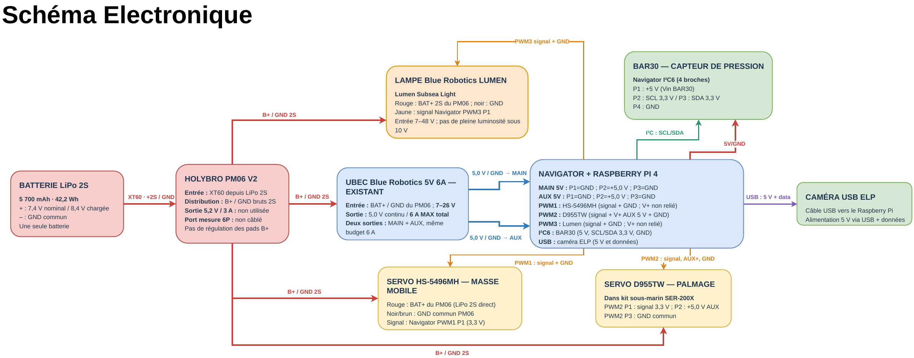

<h1 align="center">United Team</h1>

<p align="center">
  <strong>Robot-poisson pour l'exploration karstique</strong><br>
</p>

<p align="center">
  Kadijatou Diallo · Elodie Conan · Luíza Diesel Chesani · Tom Voisine · Alexandre Pinard · Matys BIECHE
</p>

<p align="center">
  <a href="#télécharger-le-simulateur">Téléchargements</a> ·
  <a href="#simulation-unity">Simulation</a> ·
  <a href="#ros-2-et-logiciel-embarqué">ROS 2</a> ·
  <a href="#organisation-du-dépôt">Organisation</a> ·
  <a href="#mécanique">Mécanique</a> ·
  <a href="#électronique">Électronique</a> ·
  <a href="#budget">Budget</a>
</p>

Le projet développe un robot aquatique propulsé par une palme, dont l'assiette est modifiée par une masse mobile interne. Le dépôt rassemble la conception du robot, le logiciel destiné au Raspberry Pi et à la carte Navigator, ainsi qu'un simulateur permettant d'explorer son comportement dans une piscine et des galeries karstiques inondées.

## Télécharger le simulateur

**Aucune installation de Unity n'est nécessaire pour utiliser les builds.** Télécharger l'archive correspondant à votre système, puis l'extraire entièrement avant de lancer le simulateur.

| Plateforme | Téléchargement du build complet | Exécutable après extraction |
| --- | --- | --- |
| Linux x86_64 | [**Télécharger pour Linux (.zip)**](https://media.githubusercontent.com/media/Ingenierie-Systeme/united-team-repo/main/downloads/United-Team-Linux-x86_64.zip) | `United-Team-Linux/Simulator_Linux.x86_64` |
| Windows x86_64 | [**Télécharger pour Windows (.zip)**](https://media.githubusercontent.com/media/Ingenierie-Systeme/united-team-repo/main/downloads/United-Team-Windows-x86_64.zip) | `United-Team-Windows/IngeSys.exe` |

Conserver l'exécutable avec son dossier de données et toutes les bibliothèques fournies : déplacer uniquement le fichier `.exe` ou `.x86_64` empêche le lancement. Ces archives contiennent les builds fournis dans le dépôt ; elles ne sont pas régénérées automatiquement lorsque les sources Unity changent.

Archives mises à jour le **4 novembre 2026** : **117,2 Mio pour Linux**, **120,2 Mio pour Windows**. Les liens de téléchargement seront actualisés après publication de ces ZIP via Git LFS sur `main`.

**Windows :** extraire le ZIP, ouvrir `United-Team-Windows`, puis lancer `IngeSys.exe`.

**Linux :** extraire le ZIP, ouvrir un terminal dans le dossier contenant `United-Team-Linux`, puis exécuter :

```bash
cd United-Team-Linux
chmod +x Simulator_Linux.x86_64
./Simulator_Linux.x86_64
```

### Commandes du simulateur

Cliquer dans la fenêtre de jeu pour donner le focus au clavier.

| Touche | Action |
| --- | --- |
| `W` | Activer / désactiver la propulsion |
| `↑` / `↓` maintenues | Déplacer la consigne de masse vers l'avant / l'arrière |
| `R` | Recentrer progressivement la masse mobile |
| `←` / `→` | Sélectionner le virage gauche / droite ; un second appui identique revient en ligne droite |
| `F` | Allumer / éteindre la lampe |
| `V` | Alterner entre les vues de base, embarquée et arrière |

## Simulation Unity

**[Ouvrir le dossier du projet Unity](<Simulateur Unity/IngeSys/IngeSys>)** · Version de l'éditeur : **6000.6.5f1**, pipeline de rendu Built-in.

La scène principale est [`RobotFishKatarstique.unity`](<Simulateur Unity/IngeSys/IngeSys/Assets/Scenes/RobotFishKatarstique.unity>) : une piscine donne accès à un puits et à un réseau de galeries inondées. Elle comporte le robot pilotable, plusieurs caméras, une lampe et une ambiance sous-marine. C'est la scène activée dans les Build Settings actuels.

Pour travailler sur les sources, ouvrir `Simulateur Unity/IngeSys/IngeSys` dans Unity Hub avec la version indiquée, ouvrir cette scène, puis lancer **Play**.

Le modèle comprend :

- Un corps rigide à six degrés de liberté, la gravité et une flottabilité distribuée selon le volume immergé.
- Des traînées linéaires et quadratiques, ainsi qu'un amortissement angulaire.
- Une masse coulissante qui déplace le centre de gravité et modifie l'assiette.
- Une palme animée avec des forces moyennes de propulsion et de direction.
- Une surface de Gerstner commune au rendu de l'eau et au calcul d'immersion.
- Des capteurs idéaux d'IMU, de pression et de profondeur publiés vers ROS 2.

Les masses, inerties et coefficients hydrodynamiques non mesurés restent provisoires. Les vagues agissent sur l'immersion et la flottabilité près de la surface.


## ROS 2 et logiciel embarqué

Deux espaces distincts sont présents dans le dépôt :

| Dossier | Rôle |
| --- | --- |
| [`ROS2/`](ROS2) | Passerelle ROS-TCP-Endpoint pour Unity et scripts de vérification des capteurs simulés. La procédure documentée utilise ROS 2 Jazzy. |
| [`ros2_ws/`](ros2_ws) | Logiciel du robot réel sur Raspberry Pi 4 / Navigator : acquisition des capteurs, commande PWM, radiocommande SBUS, caméra USB et fusion d'attitude. |

### Capteurs simulés

La connexion utilise par défaut `127.0.0.1:10000`. Le connecteur Unity est embarqué dans `Packages/com.unity.robotics.ros-tcp-connector` ; le serveur Python se trouve dans `ROS2/src/ROS-TCP-Endpoint`.

| Topic | Type ROS 2 | Mesure |
| --- | --- | --- |
| `/imu/data` | `sensor_msgs/msg/Imu` | Orientation, vitesse angulaire et accélération spécifique |
| `/barometer/pressure` | `sensor_msgs/msg/FluidPressure` | Pression absolue en Pa |
| `/depth` | `std_msgs/msg/Float64` | Profondeur immergée en mètres, positive vers le bas |

Fréquence demandée : **20 Hz**. Les capteurs sont idéaux, sans bruit ni biais ; l'horodatage utilise l'heure UTC du système. Il n'y a pas de publication de TF ni de `/clock`.

**[Procédure complète de connexion et de vérification Unity → ROS 2](ROS2/README.md)**.

### Robot réel

Le package [`navigator`](ros2_ws/src/navigator) contient les nœuds d'acquisition IMU/magnétomètre, de baromètre, de caméra, de réception SBUS et de fusion d'attitude. Les outils de calibration IMU sont dans [`imu_calib`](ros2_ws/src/imu_calib).

## Organisation du dépôt

```text
.
├── CAO/                         Pièces et assemblages mécaniques
├── Schemas/                     Schéma électronique PDF et aperçu PNG
├── Slides RDV/                  Présentations des rendez-vous projet
├── Simulateur Unity/
│   └── IngeSys/IngeSys/          Racine du projet Unity
│       ├── Assets/
│       │   ├── CAD/             Piscine, grotte et géométries dérivées
│       │   ├── Documentation/   Modèle, phases et résultats historiques
│       │   ├── Materials/       Matériaux du robot et de l'eau
│       │   ├── Prefabs/          RobotFish partagé
│       │   ├── Scenes/           Démonstrations et scènes de validation
│       │   ├── Scripts/
│       │   │   ├── Robot/        Physique, actionneurs, clavier et capteurs
│       │   │   ├── Environment/  Eau, vagues et ambiance sous-marine
│       │   │   ├── Diagnostics/  HUD et caméras
│       │   │   └── Editor/       Outils de construction de la scène karstique
│       │   ├── Shaders/          Rendu des particules sous-marines
│       │   └── Tests/Simulation/ Bancs de validation physique
│       ├── Packages/            Dépendances et connecteur ROS TCP embarqué
│       └── ProjectSettings/     Réglages Unity
├── ROS2/                        Passerelle du simulateur et vérifications
├── ros2_ws/src/                  Logiciel embarqué et calibration IMU
├── Linux Simulator/             Build Linux décompressé
├── Windows Simulator/           Build Windows décompressé
└── downloads/                   Archives des builds à télécharger
```

## Mécanique

La [CAO](CAO) regroupe les pièces et assemblages du robot :

- `Assembly/` : assemblage exporté en OBJ avec son fichier de matériaux.
- `Lampe/` : pièces Inventor du support de lampe.
- `Servo/` : pièces du servo et de son bras.
- `Pale/` : assemblage de palme et pièces aux formats Inventor, STEP et STL.
- À la racine : aileron et support du système de masse mobile.

## Électronique

Conception des cartes, choix des composants et intégration électronique.

**Consulter le schéma :** [Schéma électronique (PDF)](Schemas/SchémaElec.drawio.pdf).

[](Schemas/SchémaElec.drawio.pdf)

L’architecture électronique repose sur une batterie LiPo 2S de 5 700 mAh (7,4 V nominal, 8,4 V chargée). Le module Holybro PM06 V2 distribue la tension de la batterie aux équipements. Un UBEC Blue Robotics abaisse cette tension à 5 V pour alimenter la carte Navigator et le Raspberry Pi 4 via les entrées MAIN et AUX. Ces deux sorties partagent un budget de courant total de 6 A.

La carte Navigator assure la commande des actionneurs et l’acquisition capteurs :

- Le servomoteur HS-5496MH déplace la masse mobile. Il est alimenté directement par la batterie via le PM06 et reçoit son signal de commande sur PWM1.
- Le servomoteur D955TW assure le palmage. Il est commandé sur PWM2 et alimenté par le rail AUX à 5 V.
- La lampe Blue Robotics Lumen est alimentée par la batterie via le PM06 et commandée sur PWM3. La pleine luminosité ne sera pas disponible sous 10 V, ce qui limite l’éclairage avec une batterie 2S.
- Le capteur de pression BAR30 est raccordé au port I²C : alimentation à 5 V et lignes de communication SCL/SDA à 3,3 V.
- La caméra USB ELP est reliée au Raspberry Pi, qui fournit son alimentation à 5 V et reçoit les données vidéo par USB.

Tous les équipements partagent une masse commune (GND). Pour PWM1 et PWM3, seuls le signal et la masse sont raccordés à la Navigator, puisque le servomoteur de masse mobile et la lampe disposent de leur propre alimentation depuis le PM06.

## Budget

[Bill of Materials & Budget](https://docs.google.com/spreadsheets/d/1Qr9bEgOpJ-lRK8r1bVk7Ykp1GppL0cOrZnI6PdFquQw/edit?gid=0#gid=0)

- Prix des matériaux et composants: **1 735 €**
- Coût masse salariale (ingénieurs): **9 240 €**

|  | Total | Composition du coût |
| --- | --- |---|
| **Prototype** | 10 135 € |BOM + matériaux + Coût Ingénieur|
| **Robot fini** | 2 575 € |BOM + matériaux + Coût technicien|

## Ressources de l'équipe

- [Espace Canva](https://canva.link/1owfrv3v93n80cp)
- [Dossier Google Drive](https://drive.google.com/drive/folders/1FjV8GK_41jrpMsA0FTS6ITrTZtgfy01Q?usp=sharing)
- [Présentations des rendez-vous](<Slides RDV>)

## Licence

Voir le fichier [LICENSE](LICENSE). Les composants tiers embarqués conservent leurs licences respectives.
